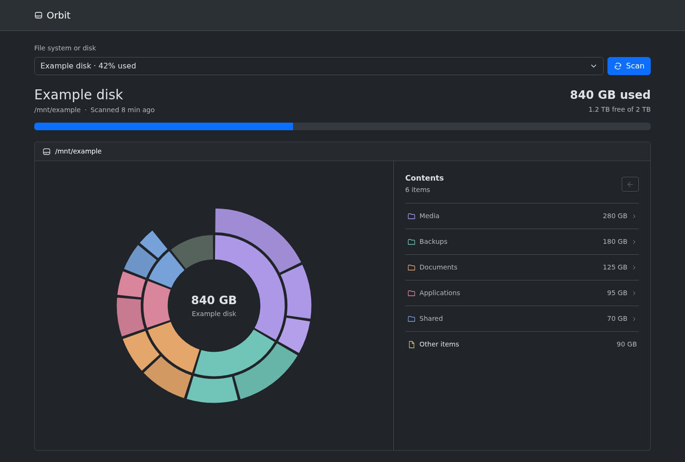

# Orbit

A small, self-hosted disk usage viewer for Linux.



*Screenshot uses example data.*

## Features

- Live used and free capacity.
- Interactive directory map and folder navigation.
- Automatic targets for `/`, mounted filesystems, and mounted disks.
- Atomic scan snapshots: a cancelled or failed scan keeps the last complete map.
- Read-only operation with no file editing, moving, or deletion.

## Run

Create `compose.yaml`:

```yaml
services:
  orbit:
    image: ghcr.io/sjtrny/orbit:latest
    restart: unless-stopped
    read_only: true
    cap_drop: [ALL]
    security_opt: ["no-new-privileges:true"]
    ports: ["127.0.0.1:8080:8080"]
    volumes:
      - /:/host:ro,rslave
      - orbit-data:/data

volumes:
  orbit-data:
```

```bash
docker compose up -d --pull always
```

Updates to `main` automatically publish Linux AMD64/ARM64 images tagged `latest`
and `sha-<commit>`. The image is public; no registry login is needed. Run the
command above again to update your container.

Open <http://localhost:8080/>. Orbit discovers `/` and its mounted filesystems
when it starts; restart it after mounts change. A disk must have a mounted
filesystem because Orbit does not inspect raw block devices. Orbit has no
login, so use an authenticated reverse proxy before exposing it.

## State and safety

Completed maps persist in the `orbit-data` Docker volume. The container root
and host mounts are read-only, all Linux capabilities are dropped, and scans do
not follow symlinks or cross filesystem boundaries.

The map counts allocated blocks and counts hard links once. Unreadable entries
are reported. Live filesystem capacity can differ from a completed scan because
of metadata, protected files, deleted-but-open files, or later changes.

## Check

```bash
python3 -m unittest discover -s tests -v
node --check static/app.js
node tests/browser.cjs
```
